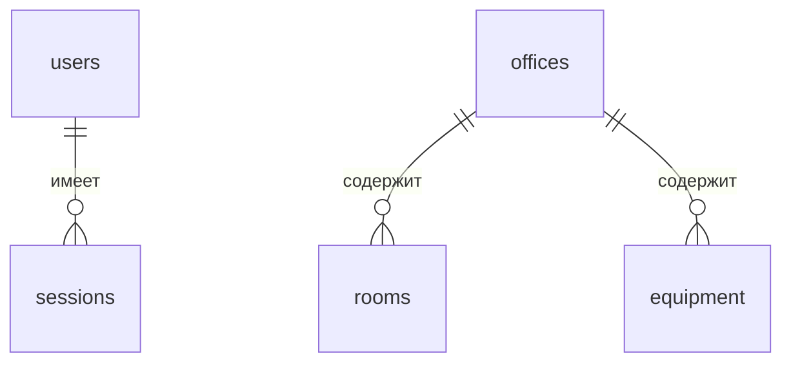

# База данных Roomly

Документ описывает **текущую реализацию** по моделям SQLAlchemy и миграциям `0001` и `0002`. Приложение использует PostgreSQL 17; подключение задаётся переменной `DATABASE_URL`. Проектируемые, но ещё не созданные таблицы описаны в [ТЗ](room-booking-specification.md).

## Связи

Первичные ключи — `id`, кроме `sessions`, где ключом является `token_hash`. Все перечисленные ниже поля обязательны: `NULL` не допускается. Значения `active=true` задаются SQLAlchemy при создании объектов; серверного значения по умолчанию в миграции нет.

## Таблицы

### `users` — учётные записи

| Поле | Тип PostgreSQL | Назначение и ограничения |
| --- | --- | --- |
| `id` | `integer` | Первичный ключ. |
| `email` | `varchar(254)` | Уникальный идентификатор пользователя. При создании через API и инициализации пробелы по краям удаляются, буквы приводятся к нижнему регистру; само ограничение уникальности базы регистр не нормализует. |
| `display_name` | `varchar(120)` | Отображаемое имя. |
| `password_hash` | `varchar(256)` | Хеш пароля с солью; пароль в открытом виде не хранится. |
| `role` | `varchar(20)` | Роль `admin` или `user`; проверяется ограничением `user_role`. |
| `active` | `boolean` | Признак активности учётной записи. |

Хеш пароля формируется с помощью PBKDF2-HMAC-SHA256, случайной соли и 600 000 итераций. Формат хранения: `pbkdf2_sha256$600000$<salt>$<digest>`.

### `sessions` — сессии входа

| Поле | Тип PostgreSQL | Назначение и ограничения |
| --- | --- | --- |
| `token_hash` | `varchar(64)` | Первичный ключ; SHA-256 от токена сессии, который передаётся клиенту в cookie. |
| `user_id` | `integer` | Внешний ключ на `users.id`; при удалении пользователя его сессии удаляются каскадно. Поле индексировано. |
| `csrf_hash` | `varchar(64)` | SHA-256 от действующего CSRF-токена. |
| `expires_at` | `timestamp with time zone` | Время истечения сессии; при входе назначается срок в восемь часов. |

После выхода удаляется текущая сессия, а после смены или сброса пароля — все сессии пользователя. Проверка срока действия выполняется приложением при обращении; автоматическое удаление истёкших записей сейчас не реализовано.

### `offices` — офисы

| Поле | Тип PostgreSQL | Назначение и ограничения |
| --- | --- | --- |
| `id` | `integer` | Первичный ключ. |
| `name` | `varchar(120)` | Уникальное название. |
| `timezone` | `varchar(64)` | Название часового пояса IANA. Проверка допустимости имени в текущей схеме отсутствует. |
| `active` | `boolean` | Признак активности. |

### `rooms` — переговорные

| Поле | Тип PostgreSQL | Назначение и ограничения |
| --- | --- | --- |
| `id` | `integer` | Первичный ключ. |
| `office_id` | `integer` | Внешний ключ на `offices.id`; поле индексировано. |
| `name` | `varchar(120)` | Название, уникальное в сочетании с `office_id`. |
| `category` | `varchar(20)` | `small`, `medium` или `large`; проверяется ограничением `room_category`. |
| `capacity` | `integer` | Вместимость больше нуля; ограничение `room_capacity`. |
| `active` | `boolean` | Признак активности. |

### `equipment` — отдельные единицы оборудования

| Поле | Тип PostgreSQL | Назначение и ограничения |
| --- | --- | --- |
| `id` | `integer` | Первичный ключ. |
| `office_id` | `integer` | Внешний ключ на `offices.id`; поле индексировано. |
| `type` | `varchar(20)` | `projector` или `speakerphone`; проверяется ограничением `equipment_type`. |
| `label` | `varchar(120)` | Обозначение единицы, уникальное в сочетании с `office_id`. |
| `active` | `boolean` | Признак активности, не статус ремонта. |

## Начальные данные

При запуске Compose после миграции вызывается `python -m app.seed`. Начальные данные добавляются в одной транзакции:

| Офис | Часовой пояс | Комнаты | Оборудование |
| --- | --- | --- | --- |
| New York | `America/New_York` | Small — 4, Medium — 10, Large — 20 | По два проектора и устройства громкой связи |
| London | `Europe/London` | То же | То же |
| Moscow | `Europe/Moscow` | То же | То же |
| Tokyo | `Asia/Tokyo` | То же | То же |

Скрипт ищет существующие офисы по названию, комнаты и оборудование — по офису и названию или обозначению. Повторный последовательный запуск не дублирует эти записи и не обновляет их поля. Если в базе нет ни одного пользователя с ролью `admin`, создаётся первый администратор из `INITIAL_ADMIN_EMAIL` и `INITIAL_ADMIN_PASSWORD`. При наличии администратора его данные и пароль не меняются. Переменная `active` при этой проверке не учитывается.

## Миграции и хранение

Alembic хранит текущую ревизию в служебной таблице `alembic_version`. Исходная миграция: [0001_initial.py](../migrations/versions/0001_initial.py). При старте контейнера выполняется `alembic upgrade head`, затем инициализация. Данные PostgreSQL хранятся в именованном томе Compose `roomly-data`; имя Docker-тома зависит от имени Compose-проекта. Остановка контейнера не удаляет том.

## Пока не реализовано

Миграция `0002` задаёт таблицы напрямую в SQL; ORM-модели для них пока не добавлены. Она создаёт предварительные таблицы `booking_series`, `bookings`, `booking_rooms`, `equipment_allocations`, `equipment_repairs` и `equipment_repair_events`. В них применяются внешние ключи и ограничения исключения пересекающихся активных выделений комнат и оборудования. Интервал и статус выделений связаны с бронированием составными внешними ключами и обновляются каскадно. Таблицы пока не используются API. Проверки вместимости, числа встреч в серии и пересечений ремонта с выделениями, а также транзакционные операции бронирования и ремонта ещё предстоит реализовать на этапах 6–8.

## Предварительные таблицы бронирований и ремонта

| Таблица | Основные поля и ограничения |
| --- | --- |
| `booking_series` | Идентификатор, периодичность `daily`, `weekly` или `monthly`, исходный часовой пояс и время создания. |
| `bookings` | Организатор, необязательная серия, начало и окончание с часовым поясом, исходный пояс, статус и время создания и отмены. Продолжительность — от 30 минут до 4 часов; для отменённой встречи требуется время отмены. |
| `booking_rooms` | Бронирование, комната, офис, число участников, интервал и статус. Одна комната на офис в бронировании; комната должна принадлежать указанному офису. |
| `equipment_allocations` | Выделение конкретного устройства комнате, офис, интервал и статус. Устройство должно принадлежать указанному офису. |
| `equipment_repairs` | Устройство, автор, начало и окончание ремонта, время создания и необязательная причина. Для одного устройства периоды ремонта не пересекаются. |
| `equipment_repair_events` | История изменений окончания ремонта с автором, предыдущим и новым временем, моментом изменения и причиной. |

Для ограничений диапазонов используется расширение PostgreSQL `btree_gist`; роль, применяющая миграцию, должна иметь право установить расширение. Ограничения пересечения срабатывают для активных выделений, полуоткрытые интервалы допускают смежные встречи. Проверка пересечений между таблицами ремонта и выделения оборудования не реализована базой и потребует согласованной транзакционной логики на этапах бронирования и ремонта.
